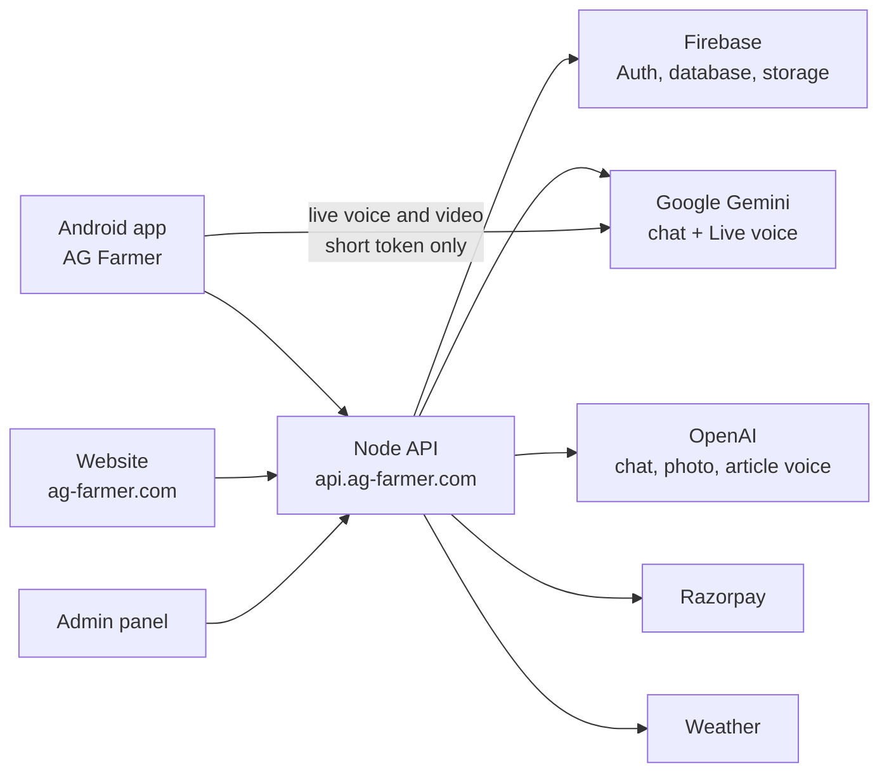
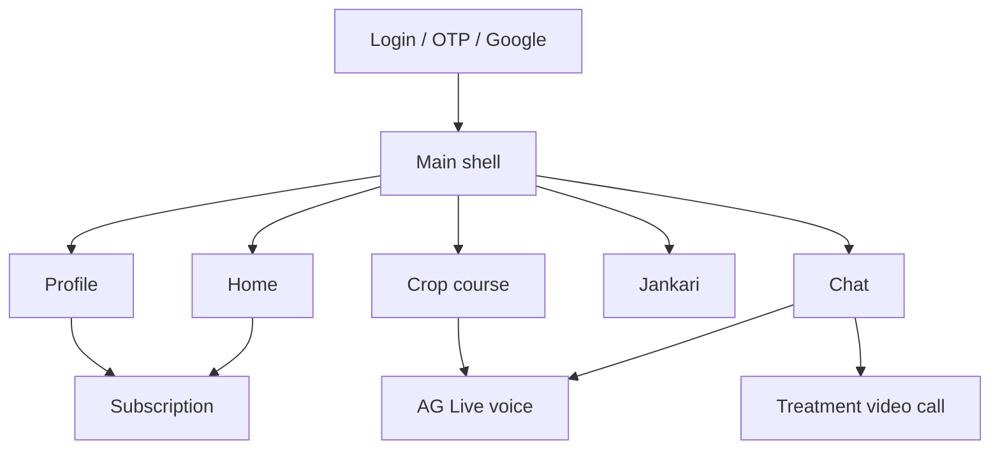
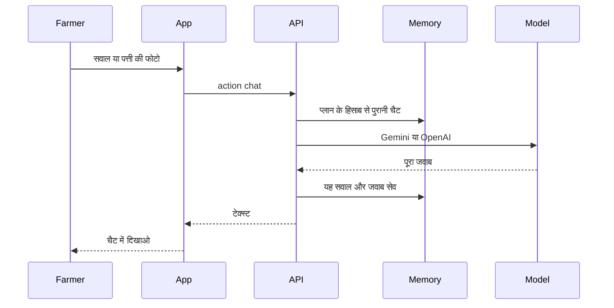
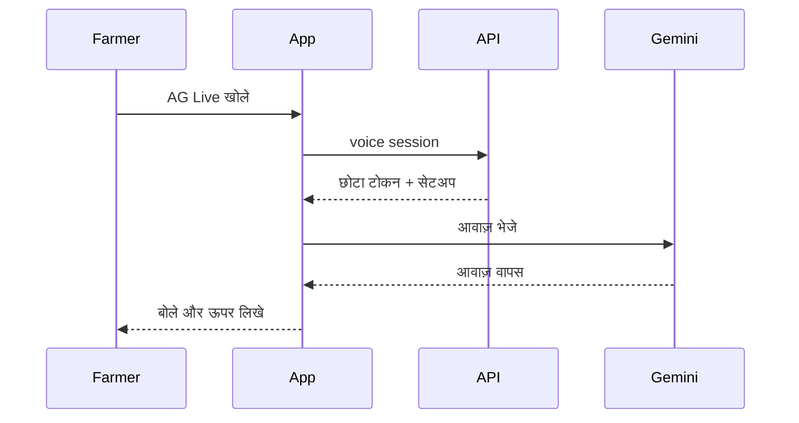
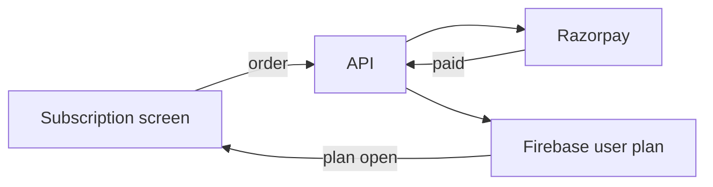
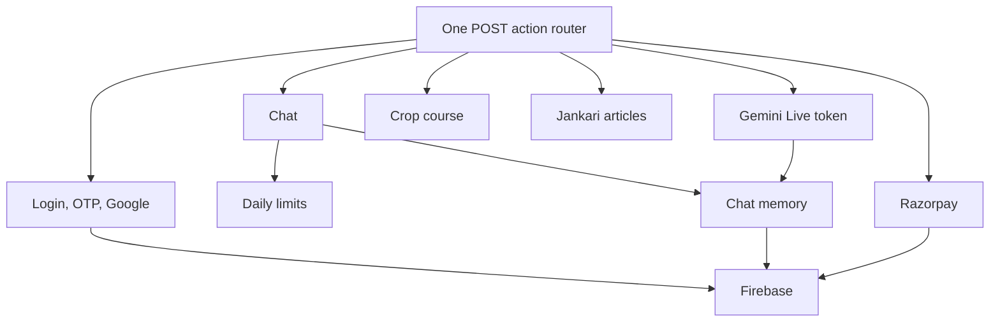

# AG Farmer — Blueprint

किसान ऐप। पैकेज `com.agfarmer.app`. आवाज़ और वीडियो **Gemini 3.8 Live** से चलते हैं। टाइप चैट Gemini और OpenAI दोनों से चल सकती है। पैसा Razorpay से बनता है।

## 1. पूरा सिस्टम

ऐप कभी API की असली चाबी नहीं रखता। चाबी सिर्फ सर्वर पर रहती है। लाइव कॉल के लिए सर्वर एक छोटा टोकन देता है, फोन उसी से Google से जुड़ता है।

## 2. ऐप की स्क्रीन

नीचे पाँच टैब हैं: होम, चैट, कोर्स, जानकारी, प्रोफाइल।

## 3. चैट का रास्ता

याद रखने की सीमा:

| प्लान | पुरानी चैट |
| --- | --- |
| ₹299 | 5 |
| ₹599 | 10 |
| ₹2,650 | 30 |
| ₹13,500 | 300 |

एक चैट का मतलब किसान का सवाल और उसका जवाब। फ्री और पुराना ₹99 प्लान पुरानी चैट याद नहीं रखते।

## 4. AG Live आवाज़

जवाब में वजह, बीघा और लीटर-पंप की मात्रा, समय, तरीका और एक सावधानी आती है। “कृषि विशेषज्ञ से पूछ लें” बोलकर नहीं आता। वह लाइन कॉल काटने वाले बटन के ऊपर लिखी रहती है।

वीडियो कॉल भी यही Live मॉडल है। फर्क यह है कि कैमरे की फोटो भी साथ जाती है। पहली लाइन फसल की तरफ कैमरा करने को कहती है।

## 5. पेमेंट

Razorpay की सीक्रेट चाबी सिर्फ सर्वर पर है। सफल पेमेंट के बाद ही प्लान खुलता है।

## 6. सर्वर के मुख्य हिस्से

जानकारी वाले लेख की “बोलें” आवाज़ OpenAI की है, Gemini Live की नहीं।
