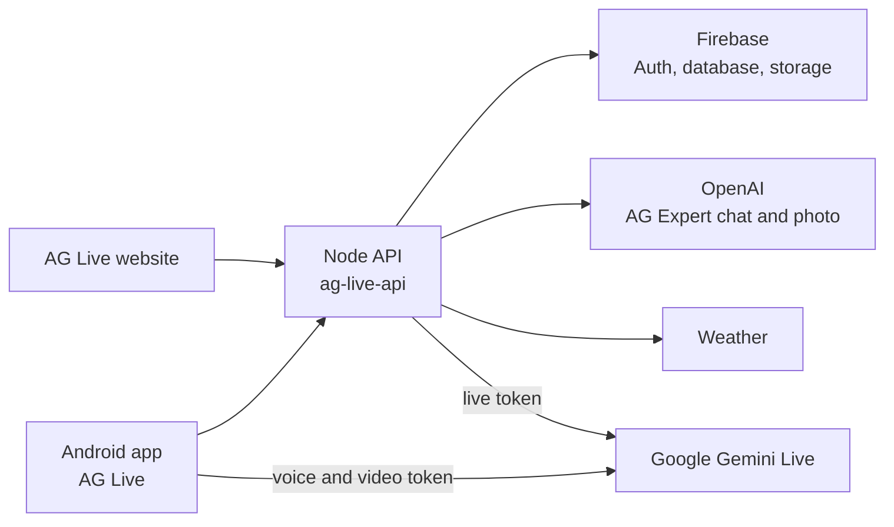
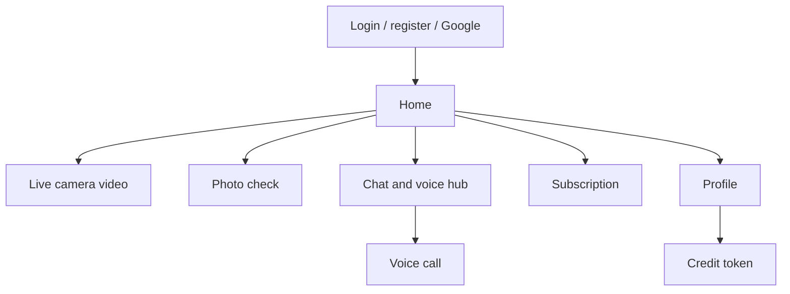
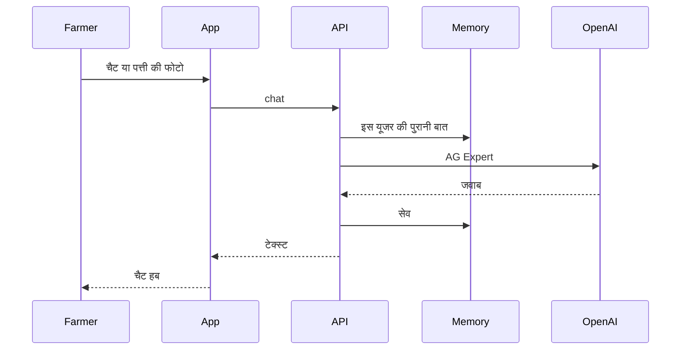
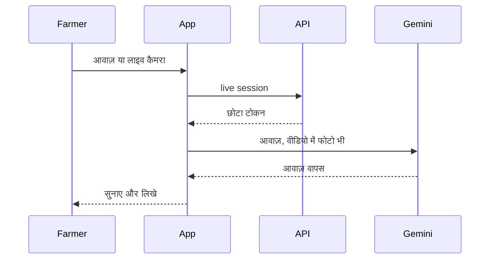
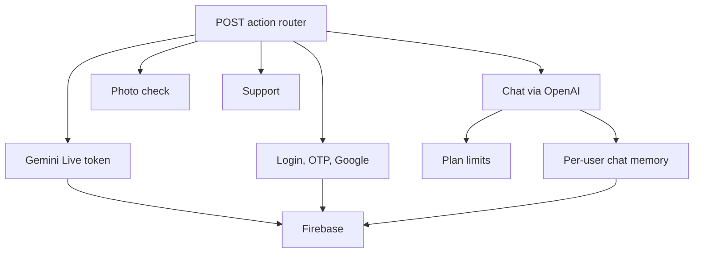

# AG Live — Blueprint

अलग ऐप और अलग सर्वर। होम पर तीन दरवाजे हैं: लाइव कैमरा, फोटो जाँच, और चैट व आवाज़। टाइप चैट पहले OpenAI की है। लाइव आवाज़ और वीडियो Gemini 3.8 Live की हैं।

## 1. पूरा सिस्टम

AG Farmer का Razorpay और जानकारी-लेख वाला बोलने वाला बटन इस ऐप के सर्वर पर नहीं है। दोनों ऐप एक ही मशीन पर अलग प्रोसेस में चलते हैं। एक को रीस्टार्ट करने से दूसरा नहीं रुकता।

## 2. ऐप की स्क्रीन

होम के तीन बड़े कार्ड: लाइव कैमरा, फोटो जाँच, चैट और आवाज़।

## 3. चैट और फोटो

चैट का पहला मॉडल OpenAI है। Gemini चैट भी सर्वर पर मौजूद है, पर डिफॉल्ट AG Expert है।

## 4. आवाज़ और वीडियो

वीडियो कॉल लॉग-इन यूजर को सुपर प्लान माँगती है। गेस्ट को एक मुफ्त वीडियो ट्रायल मिलता है।

## 5. सर्वर के मुख्य हिस्से

डेटा Firebase पर यूजर की अपनी जगह में रहता है: `users/{uid}/ai` और ईमेल वाली कॉपी। चैट की खिड़की नाम वाले सेशन में रहती है। कोर्स की बात फसल के थ्रेड में रहती है।
